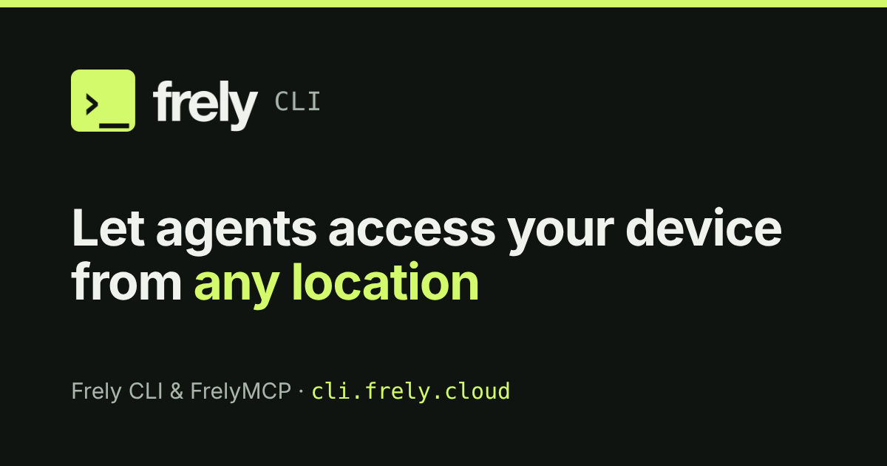

# Frely CLI

[](https://cli.frely.cloud/)

[Website](https://cli.frely.cloud/) · [Docs](https://cli.frely.cloud/docs/) · [Freely](https://frely.cloud/) · [English](README.md) · [简体中文](README.zh-CN.md)

Frely CLI (`frely-cli`) connects AI agents to your devices: remote computers, local servers, and shared models. For web ChatGPT and Claude, it connects computers you choose to **FrelyMCP** so those clients can use the files and commands in the folders you allow. For your own agents (Claude Code, Codex, pi), it lets them run and update Skills from the terminal.

## Features and Installation

### Want web ChatGPT or Claude to access your devices?
1. [Add FreelyMCP to web agents](#add-freelymcp-to-web-agents)
2. [Install Freely CLI on your computer](#install-freely-cli-on-your-computer)

### Want AI agents to access local or remote devices?
1. [Install Freely CLI on your computer](#install-freely-cli-on-your-computer)

### Want to share local models with friends?
1. [Install Freely CLI on your computer](#install-freely-cli-on-your-computer)
2. **Local model sharing**: `frely service share model ollama` publishes a local model server's models as your personal Freely Provider. [Details](https://cli.frely.cloud/docs/help/share-local-model/)

## Step-by-Step Instructions

### Install Freely CLI on your computer

#### A. Let your agent install Freely CLI

Ask an agent that has a shell (Claude Code, Codex, pi) to install the CLI, sign in and install the Skill:

```text
Install Freely CLI and the frely Skill on this computer. First ask the user for their email, and whether they also want to allow remote control of this computer (for example from ChatGPT or Claude on the web). Then, using that email, run the installer for this operating system: on macOS or Linux run curl -fsSL https://frely.cloud/install.sh | sh -s -- --quiet --email <my email>; on Windows PowerShell run curl.exe -fsSLo "$env:TEMP\frely-install.ps1" https://frely.cloud/install.ps1; powershell -NoProfile -ExecutionPolicy Bypass -File "$env:TEMP\frely-install.ps1" -Quiet -Email <my email>. The installation emails me a 6-digit code: ask me for it, then run frely login --code <code> --host <your host: claude-code, codex, pi or generic> --quiet (add --link on if I agree to remote control; otherwise do not), and read the Skill it installs.
```

The installed `frely` Skill teaches the agent to use your account, and to suggest FreelyMCP only when a request needs it. This path does not expose this computer to remote clients; `frely link on` does. [Details](https://cli.frely.cloud/zh/#skill)

#### B. Install Freely CLI manually

`https://frely.cloud/install.sh` and `install.ps1` only install the program, for scripts and agents that need the CLI. You can also use npm (Node.js 22 or newer required):

```sh
# macOS / Linux
curl -fsSL https://frely.cloud/install.sh | sh
# For agents: quiet output (details on failure only), sends the login code email right away
curl -fsSL https://frely.cloud/install.sh | sh -s -- --quiet --email you@example.com
```

```powershell
# Windows (PowerShell)
curl.exe -fsSLo "$env:TEMP\frely-install.ps1" https://frely.cloud/install.ps1; powershell -NoProfile -ExecutionPolicy Bypass -File "$env:TEMP\frely-install.ps1"
```

Or with npm:

```sh
npm install --global --ignore-scripts frely-cli@latest
```

The installers verify SHA-256, download from GitHub Releases first, then fall back to npmmirror and npmjs. [Details](https://cli.frely.cloud/docs/help/install-only/)

Then sign in and install the Skill for your agent host:

```sh
frely login --email <you@example.com>   # Then run: frely login --code <6-digit code> [--host <host>] [--link on] (installs Skill; --link on also turns on remote control)
frely skill install --host <claude-code|codex|pi|workbuddy|codebuddy|generic>
```

### Add FreelyMCP to web agents

1. Find the connectors section in your settings, add a new connector/MCP
2. Name the connector anything, we recommend `FreelyMCP`
3. For the connector URL, enter `https://freely.cloud/mcp`
4. For authentication, select `OAuth`
> If you don't have a Freely account, you'll be directed to the Freely login page, where you can create a new account using your email.

#### ChatGPT Tutorial
Tutorial [https://freely.cloud/docs/chatgpt](https://freely.cloud/docs/chatgpt/)

#### Claude Tutorial
Tutorial [https://freely.cloud/docs/claude](https://freely.cloud/docs/claude/)

## Common Commands

| Command | What it does |
| --- | --- |
| `frely skill install --host <host>` | Install the `frely` Skill for an agent host (`claude-code`, `codex`, `pi` or `generic`). |
| `frely link on` | Turn remote control on: sign in if needed, approve this computer in the browser, start the background service and print the MCP URL. Safe to re-run: it renews expired access and starts a stopped service. |
| `frely link off` | Turn remote control off: revoke access for every client and lock it on this computer, so only `frely link on` here turns it on again. The background service is uninstalled, or kept running for local Providers. |
| `frely link status` | Show whether remote control is on, off or not enabled yet, with the MCP URL, workspace, expiry and service state. |
| `frely link workspace add <path>` | Share another folder. `frely link workspace list` shows them all. |
| `frely doctor` | Check sign-in, installation, service and connection. `-v` for details. |
| `frely update` | Update to the latest version in place. |
| `frely login` / `frely logout` | Sign in or out of Freely account. |
| `frely sandbox proxy <url>` | Forward the command sandbox's network traffic to your own HTTP(S) proxy. Without it the CLI uses `HTTPS_PROXY` / `HTTP_PROXY` / `ALL_PROXY` and, on macOS, the system proxy. `--clear` removes it. A running background service restarts to apply the change. |
| `frely tunnel <host>:<port>` | Inside a sandboxed command: listen on `127.0.0.1` and forward TCP connections to `host:port` through the sandbox, for database and redis clients. `--local-port N` picks the local port. |
| `frely uninstall` | Remove Freely from this computer (lists everything first). |

All commands and options: [command reference](https://cli.frely.cloud/docs/help/commands/). `frely help --agent --json` prints the full machine-readable contract.

## Safety

File tools stay inside the shared workspaces and protect credential and shell start-up files. Commands run as your OS user inside an OS sandbox, and are refused where the computer cannot sandbox them. Clients hold OAuth tokens; the CLI keeps its own key in the system credential store. [Is it safe?](https://cli.frely.cloud/docs/help/is-it-safe/) · [Sandbox and permissions](https://cli.frely.cloud/docs/help/sandbox-and-permissions/) · [Credential storage](docs/credential-storage.md)

## Documentation

- Help: [cli.frely.cloud/docs](https://cli.frely.cloud/docs/) ([update](https://cli.frely.cloud/docs/help/update/), [doctor](https://cli.frely.cloud/docs/help/doctor/), [uninstall](https://cli.frely.cloud/docs/help/uninstall/))
- Contracts, for contributors: [Device MCP](docs/device-mcp.md) · [Device Relay transport](docs/device-transport.md) · [MCP OAuth contract](docs/mcp-oauth-relay-contract.md) · [`frely api`](docs/api.md) · [Freely Network (preview)](docs/freely-network.md) · [self-update](docs/self-update.md) · [service maintenance](docs/service-maintenance.md)

## License and trademarks

`frely-cli` is licensed under the Apache License 2.0; see [`LICENSE`](LICENSE). The Freely name, logos and product names are not licensed as trademarks; see [`TRADEMARKS.md`](TRADEMARKS.md). See [`CONTRIBUTING.md`](CONTRIBUTING.md) for development and [`SECURITY.md`](SECURITY.md) to report a vulnerability.
