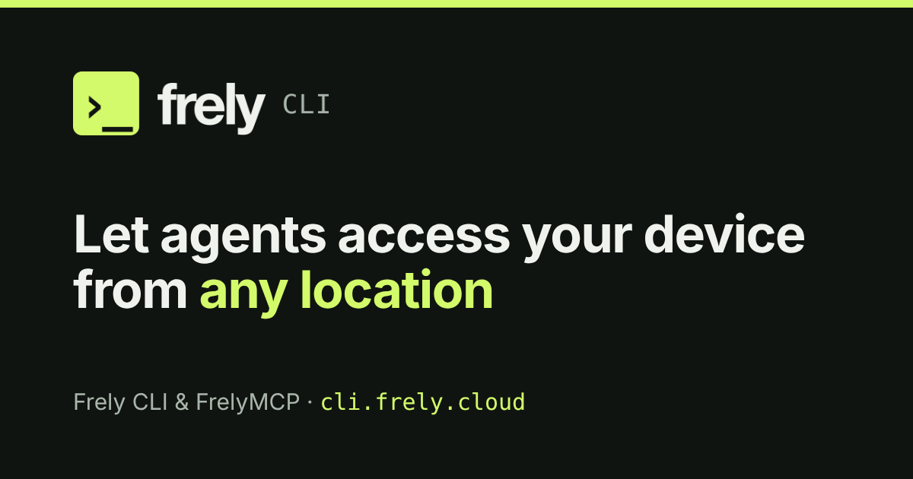

# Frely CLI

[](https://cli.frely.cloud/zh/)

[官网](https://cli.frely.cloud/zh/) · [文档](https://cli.frely.cloud/docs/) · [Frely](https://frely.cloud/) · [English](README.md) · [简体中文](README.zh-CN.md)

Frely CLI gives agents with a shell, such as Claude Code, Codex and pi, the `frely` Skill: your agent uses your Frely account and the Store from the terminal. For web ChatGPT and Claude, and to work on another computer, it connects a computer you choose to **FrelyMCP**.

它也是 Frely 账号的命令行工具：

- **Agent、Prompt 与 Skill**：把已发布的 Frely Agent 安装为本地 Skill，或安装你购买的 Prompt 和 Skill。
- **设备 MCP**：让远程 AI 客户端操作这台电脑。
- **本机 MCP 服务**：把只在这台电脑上运行的 MCP 服务（例如监听 `127.0.0.1` 的）转给远程客户端使用。
- **本地模型共享**：把本机 Ollama 或 OpenAI 兼容运行时发布为你自己的 Frely Provider。

## 安装

### 让 Agent 帮你安装

让有 Shell 的 Agent（Claude Code、Codex、pi）安装 CLI、登录并安装 Skill：

```text
Install Frely CLI and the frely Skill on this computer. On macOS or Linux run curl -fsSL https://frely.cloud/install.sh | sh; on Windows PowerShell run curl.exe -fsSLo "$env:TEMP\frely-install.ps1" https://frely.cloud/install.ps1; powershell -NoProfile -ExecutionPolicy Bypass -File "$env:TEMP\frely-install.ps1". Ask me for my email, run frely login --email <my email>, ask me for the 6-digit code from the email, then run frely login --code <code>. Then run frely skill install --host <your host: claude-code, codex, pi or generic> and read the Skill it installs. Do not run frely mcp start until I ask for it.
```

安装的 `frely` Skill 会教 Agent 使用你的账号，只在需要时才建议 FrelyMCP。这种方式不会把这台电脑开放给远程客户端，`frely mcp start` 才会。[详情](https://cli.frely.cloud/zh/#skill)

### 自己安装

`https://frely.cloud/install.sh` 和 `install.ps1` 只安装程序，供脚本和 Agent 使用。也可以用 npm（需要 Node.js 22 或更新版本）：

```sh
# macOS / Linux
curl -fsSL https://frely.cloud/install.sh | sh
```

```powershell
# Windows（PowerShell）
curl.exe -fsSLo "$env:TEMP\frely-install.ps1" https://frely.cloud/install.ps1; powershell -NoProfile -ExecutionPolicy Bypass -File "$env:TEMP\frely-install.ps1"
```

或用 npm：

```sh
npm install --global --ignore-scripts frely-cli@latest
```

安装器会校验 SHA-256，下载先走 GitHub Releases，再回退到 npmmirror 和 npmjs。[详情](https://cli.frely.cloud/docs/help/install-only/)

然后登录并为你的 Agent 宿主安装 Skill：

```sh
frely login --email <you@example.com>   # 再运行：frely login --code <6 位验证码>
frely skill install --host <claude-code|codex|pi|generic>
```

## 常用命令

| 命令 | 作用 |
| --- | --- |
| `frely skill install --host <host>` | 为 Agent 宿主（`claude-code`、`codex`、`pi` 或 `generic`）安装 `frely` Skill。 |
| `frely mcp start` | 需要时登录，开启设备 MCP，启动服务并输出 MCP URL。可重复运行。 |
| `frely mcp status` | 显示 MCP URL、工作区、授权到期时间和服务状态。 |
| `frely mcp workspace add <path>` | 共享另一个文件夹。`frely mcp workspace list` 列出全部。 |
| `frely mcp stop` / `frely mcp start` | 暂停或恢复后台服务。 |
| `frely mcp remove` | 撤销所有客户端的访问并卸载服务。 |
| `frely doctor` | 检查登录、安装、服务和连接。`-v` 显示详情。 |
| `frely update` | 原地升级到最新版本。 |
| `frely login` / `frely logout` | 登录或退出 Frely 账号。 |
| `frely sandbox proxy <url>` | 让命令沙箱的网络流量转发到你自己的 HTTP(S) 代理。未设置时使用 CLI 进程的 `HTTPS_PROXY` / `HTTP_PROXY` / `ALL_PROXY`，macOS 上还会读系统代理。`--clear` 删除；重启服务后生效。 |
| `frely tunnel <host>:<port>` | 在沙箱命令内使用：监听 `127.0.0.1`，把 TCP 连接经沙箱转发到 `host:port`，供数据库、redis 客户端使用。`--local-port N` 指定本地端口。 |
| `frely uninstall` | 从这台电脑移除 Frely（先列出全部内容）。 |

全部命令和参数见[命令参考](https://cli.frely.cloud/docs/help/commands/)。`frely help --agent --json` 输出完整的机器可读契约。

## 与 FrelyMCP 配合使用

Use FrelyMCP from clients with no shell, such as web ChatGPT and Claude, or to work on another computer.

FrelyMCP 是整个账号共用的一个 MCP 地址：`https://mcp.frely.cloud/mcp`。每台运行过 `frely mcp start` 的电脑都在它后面。

### 连接有浏览器的电脑

```sh
# macOS / Linux
curl -fsSL https://frely.cloud/start.sh | sh
```

```powershell
# Windows（PowerShell）
curl.exe -fsSLo "$env:TEMP\frely-start.ps1" https://frely.cloud/start.ps1; powershell -NoProfile -ExecutionPolicy Bypass -File "$env:TEMP\frely-start.ps1"
```

脚本安装最新版 `frely`，打开浏览器登录（新账号可在同一页面注册），请你批准这台设备，最后输出 MCP URL。随时可以再运行一次来升级。工作区默认是用户主目录，设置 `FRELY_WORKSPACE=/path` 可共享其他文件夹。[详情](https://cli.frely.cloud/docs/help/how-do-i-install/)

### 连接服务器（无需浏览器）

在 Frely 网站 **My Devices → Add a computer → Create install command** 获取一次性安装命令，或让已连接 FrelyMCP 的 ChatGPT、Claude 添加一台电脑。粘贴到服务器上运行：

```sh
curl -fsSL https://frely.cloud/start.sh | FRELY_INSTALL_TOKEN=fit_... sh
```

它会安装 `frely`、登录你的账号、开启设备 MCP 并启动后台服务。令牌只能用一次，15 分钟内有效。Linux 上请运行 `sudo loginctl enable-linger $USER`，退出 SSH 后服务才能保持在线。[详情](https://cli.frely.cloud/docs/help/install-on-a-server/)

1. 在要被控制的电脑上运行 `frely mcp start`（上面的安装脚本已经包含这一步）。
2. 把 URL 作为使用 OAuth 的远程 MCP 服务加到客户端：
   - ChatGPT 或 Claude：用这个 URL 添加自定义连接器。
   - 另一台电脑上的 Claude Code：`claude mcp add --transport http frely "https://mcp.frely.cloud/mcp"`，然后打开 `/mcp` 完成授权。
3. 登录 Frely 并批准该客户端。

验证连接：让客户端列出工作区的顶层文件名。

- **AI 能做什么**：先 `list_devices`，再在选定的电脑上用 `read`、`edit_file`、`process`、`web_fetch`，账号操作用 `frely_list` 和 `frely_call`。[详情](https://cli.frely.cloud/docs/help/what-can-the-ai-do/)
- **本机 MCP 服务**：只监听回环地址的服务会被自动发现（`frely mcp local list`），每个都要在 Frely 上逐个开启才对远程可见。[详情](https://cli.frely.cloud/docs/help/local-mcp-servers/)
- **授权**：默认 90 天，`frely mcp start --days 1..365` 可提前续期，URL 永远不变。[详情](https://cli.frely.cloud/docs/help/authorization-expiry/)

## 更多功能

- **Frely 托管的 Agent**：`frely item install <username/name> --host claude-code` 安装为本地 Skill，`frely agent run <username/name>` 调用。[详情](https://cli.frely.cloud/docs/help/install-agents-and-items/)
- **市场里的 Prompt 和 Skill**：`frely item install <username/name> --host claude-code`（Agent 也用同一条命令，加 `@3` 指定版本 3），付费部分需要账号持有通行证。[详情](https://cli.frely.cloud/docs/help/install-agents-and-items/)
- **本地模型共享**：`frely provider share ollama` 把本机模型服务发布为你的个人 Frely Provider。[详情](https://cli.frely.cloud/docs/help/share-local-model/)
- **在终端管理账号**：`frely api list|describe|call`。[详情](https://cli.frely.cloud/docs/help/manage-account-from-cli/)

## 安全

文件工具只在共享的工作区内工作，凭据和 Shell 启动文件受保护。命令以你的系统用户身份在系统沙箱中运行，无法沙箱时直接拒绝。客户端持有 OAuth 令牌，CLI 的密钥保存在系统凭据库中。[安全吗？](https://cli.frely.cloud/docs/help/is-it-safe/) · [沙箱与权限](https://cli.frely.cloud/docs/help/sandbox-and-permissions/) · [凭据存储](docs/credential-storage.md)

## 文档

- 帮助：[cli.frely.cloud/docs](https://cli.frely.cloud/docs/)（[升级](https://cli.frely.cloud/docs/help/update/)、[诊断](https://cli.frely.cloud/docs/help/doctor/)、[卸载](https://cli.frely.cloud/docs/help/uninstall/)）
- 契约（面向贡献者）：[设备 MCP](docs/device-mcp.md) · [Device Relay 传输](docs/device-transport.md) · [MCP OAuth 契约](docs/mcp-oauth-relay-contract.md) · [`frely api`](docs/api.md) · [Frely Network（预览）](docs/frely-network.md) · [自升级](docs/self-update.md) · [服务维护](docs/service-maintenance.md)

## 许可与商标

`frely-cli` 采用 Apache License 2.0 许可，见 [`LICENSE`](LICENSE)。Frely 名称、标志和产品名不随商标授权，见 [`TRADEMARKS.md`](TRADEMARKS.md)。开发说明见 [`CONTRIBUTING.md`](CONTRIBUTING.md)，私下报告漏洞见 [`SECURITY.md`](SECURITY.md)。
