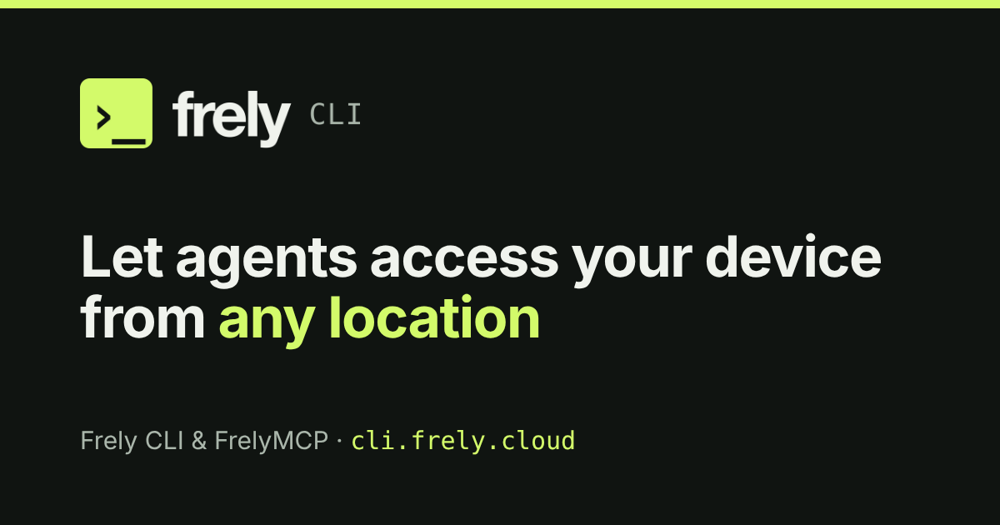

# Frely CLI

[](https://cli.frely.cloud/zh/)

[官网](https://cli.frely.cloud/zh/) · [文档](https://cli.frely.cloud/docs/) · [Frely](https://frely.cloud/) · [English](README.md) · [简体中文](README.zh-CN.md)


Frely CLI 帮您连接Agent和您的设备. 特别是网页版Claude/ChatGPT和您的多台远程设备.

## 功能与安装指南

### 想让网页Claude/CharGPT 连接本地设备?
1. [在网页端添加FrelyMCP](#在网页agent上添加frelymcp)
2. [在您的设备上安装FrelyCLI](#在设备上安装frelycli)

### 想让Agent连接本地与远程设备?
1. [在您的设备上安装FrelyCLI](#在设备上安装frelycli)

### 想要共享本地模型给朋友使用?

1. [在您的设备上安装FrelyCLI](#在设备上安装frelycli)
2. **本地模型共享**：`frely service share model ollama` 把本机模型服务发布为你的个人 Frely Provider。[详情](https://cli.frely.cloud/docs/help/share-local-model/)

## 操作步骤

### 在设备上安装FrelyCLI

#### A Agent帮你安装FrelyCLI

让有 Shell 的 Agent（Claude Code、Codex、pi）安装 CLI、登录并安装 Skill：

```text
在这台电脑上安装 Frely CLI 和 frely Skill。先向用户询问邮箱，以及是否同时允许远程控制这台电脑（例如从网页版 ChatGPT/Claude），再用这个邮箱按当前操作系统运行安装命令：macOS 或 Linux 运行 curl -fsSL https://frely.cloud/install.sh | sh -s -- --quiet --email <my email>；Windows PowerShell 运行 curl.exe -fsSLo "$env:TEMP\frely-install.ps1" https://frely.cloud/install.ps1; powershell -NoProfile -ExecutionPolicy Bypass -File "$env:TEMP\frely-install.ps1" -Quiet -Email <my email>。安装完成后会向我的邮箱发送 6 位验证码：向我索要验证码，然后运行 frely login --code <code> --host <your host: claude-code, codex, pi or generic> --quiet（如果我同意远程控制，就加上 --link on，否则不要加），并阅读它安装的 Skill。
```

安装的 `frely` Skill 会教 Agent 使用你的账号，只在需要时才建议 FrelyMCP。这种方式不会把这台电脑开放给远程客户端，`frely link on` 才会。[详情](https://cli.frely.cloud/zh/#skill)

#### B 手动安装FrelyCLI

`https://frely.cloud/install.sh` 和 `install.ps1` 只安装程序，供脚本和 Agent 使用。也可以用 npm（需要 Node.js 22 或更新版本）：

```sh
# macOS / Linux
curl -fsSL https://frely.cloud/install.sh | sh
# Agent 用：静默输出（失败才显示详情），并立即发送登录验证码邮件
curl -fsSL https://frely.cloud/install.sh | sh -s -- --quiet --email you@example.com
```

```powershell
# Windows（PowerShell）
curl.exe -fsSLo "$env:TEMP\frely-install.ps1" https://frely.cloud/install.ps1; powershell -NoProfile -ExecutionPolicy Bypass -File "$env:TEMP\frely-install.ps1"
```

或用 npm：

```sh
npm install --global --ignore-scripts frely-cli@latest
```

安装器会校验 SHA-256，下载先走 GitHub Releases，再回退到 npmmirror 和 npmjs。[详情](https://cli.frely.cloud/docs/help/install-only/)

然后登录并为你的 Agent 宿主安装 Skill：

```sh
frely login --email <you@example.com>   # 再运行：frely login --code <6 位验证码> [--host <host>] [--link on]（同时安装 Skill；--link on 同时开启远程控制）
frely skill install --host <claude-code|codex|pi|workbuddy|codebuddy|generic>
```

### 在网页Agent上添加FrelyMCP

1. 在设置中找到连接器相关页面, 添加新连接器/MCP
2. 连接器名称任意,建议使用`FrelyMCP`
3. 连接器地址填入 `https://frely.cloud/mcp`
4. 认证方式选 `OAuth`
> 如果你没有Frely账号,那么在启动认证的时候就会跳转到Frely登录页面, 你可以在Frely登录页面,使用邮箱创建新账号.

#### ChatGPT图文教程
教程 [https://frely.cloud/docs/chatgpt](https://frely.cloud/docs/chatgpt/)

#### Claude图文教程
教程 [https://frely.cloud/docs/claude](https://frely.cloud/docs/claude/)

## 常用命令

| 命令 | 作用 |
| --- | --- |
| `frely skill install --host <host>` | 为 Agent 宿主（`claude-code`、`codex`、`pi` 或 `generic`）安装 `frely` Skill。 |
| `frely link on` | 开启远程控制：需要时登录，在浏览器里批准这台电脑，启动后台服务并输出 MCP URL。可重复运行：授权过期会续期，服务停了会启动。 |
| `frely link off` | 关闭远程控制：撤销所有客户端的访问，并在本机锁定，之后只有在这台电脑上运行 `frely link on` 才能重新开启。后台服务会卸载；有本地 Provider 时继续运行。 |
| `frely link status` | 显示远程控制是开启、关闭还是尚未开启，以及 MCP URL、工作区、到期时间和服务状态。 |
| `frely link workspace add <path>` | 共享另一个文件夹。`frely link workspace list` 列出全部。 |
| `frely doctor` | 检查登录、安装、服务和连接。`-v` 显示详情。 |
| `frely update` | 原地升级到最新版本。 |
| `frely login` / `frely logout` | 登录或退出 Frely 账号。 |
| `frely sandbox proxy <url>` | 让命令沙箱的网络流量转发到你自己的 HTTP(S) 代理。未设置时使用 CLI 进程的 `HTTPS_PROXY` / `HTTP_PROXY` / `ALL_PROXY`，macOS 上还会读系统代理。`--clear` 删除。正在运行的后台服务会自动重启以生效。 |
| `frely tunnel <host>:<port>` | 在沙箱命令内使用：监听 `127.0.0.1`，把 TCP 连接经沙箱转发到 `host:port`，供数据库、redis 客户端使用。`--local-port N` 指定本地端口。 |
| `frely uninstall` | 从这台电脑移除 Frely（先列出全部内容）。 |

全部命令和参数见[命令参考](https://cli.frely.cloud/docs/help/commands/)。`frely help --agent --json` 输出完整的机器可读契约。


## 安全

文件工具只在共享的工作区内工作，凭据和 Shell 启动文件受保护。命令以你的系统用户身份在系统沙箱中运行，无法沙箱时直接拒绝。客户端持有 OAuth 令牌，CLI 的密钥保存在系统凭据库中。[安全吗？](https://cli.frely.cloud/docs/help/is-it-safe/) · [沙箱与权限](https://cli.frely.cloud/docs/help/sandbox-and-permissions/) · [凭据存储](docs/credential-storage.md)

## 文档

- 帮助：[cli.frely.cloud/docs](https://cli.frely.cloud/docs/)（[升级](https://cli.frely.cloud/docs/help/update/)、[诊断](https://cli.frely.cloud/docs/help/doctor/)、[卸载](https://cli.frely.cloud/docs/help/uninstall/)）
- 契约（面向贡献者）：[设备 MCP](docs/device-mcp.md) · [Device Relay 传输](docs/device-transport.md) · [MCP OAuth 契约](docs/mcp-oauth-relay-contract.md) · [`frely api`](docs/api.md) · [Frely Network（预览）](docs/frely-network.md) · [自升级](docs/self-update.md) · [服务维护](docs/service-maintenance.md)

## 许可与商标

`frely-cli` 采用 Apache License 2.0 许可，见 [`LICENSE`](LICENSE)。Frely 名称、标志和产品名不随商标授权，见 [`TRADEMARKS.md`](TRADEMARKS.md)。开发说明见 [`CONTRIBUTING.md`](CONTRIBUTING.md)，私下报告漏洞见 [`SECURITY.md`](SECURITY.md)。
